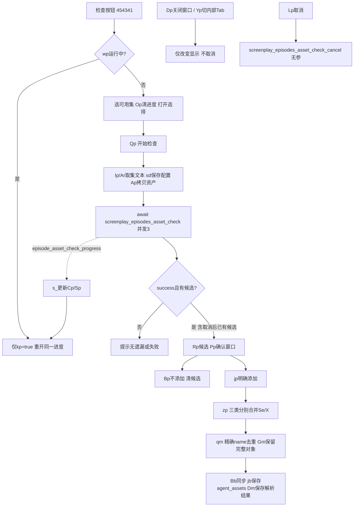

# 资产检查后台持续与确认入库：原版规格及证据

日期：2026-11-15。范围：分镜页顶部「检查」按钮，关闭检查弹窗、切换内部 Tab、重新打开进度、取消及确认候选资产。本文件先记录原版，再区分 CM 的可靠性适配；不是完成复刻或供应商调用成功的证明。

## 证据边界

原始安装目录：`F:/软件/洛水2026/洛水2026`。

可读前端证据：`_local-archive-20261028/luoshui-screenplay-reconstruction-20261115/01-readable-frontend/pretty/index-DszfAkKD.js`。以下行号均指这份文件，SHA256 为 `8c5145ee0f26f594c35c6ca954e24d87dbbb44f5506029343f211a374992e492`。这是发行包前端的恢复/格式化文件，不是原版 Python 源码。

本项证据目录：`_local-archive-20261028/luoshui-screenplay-reconstruction-20261115/07-parity-execution/asset-check-original/`。

- `extract_evidence.py`：仅读取前端及两个指定原生模块，生成带源行号的摘录、原件摘要和函数映射；不导入或执行原版模块，不读取作品或数据库。
- `manifest.json`：原件摘要、逐份摘录摘要、派生分析文件摘要及 22 个完整函数的源行号。
- `lines-*.txt`：带原件路径、摘要和行号的原文摘录。
- `native-literal-symbols.json`：`modules/api.pyd`、`modules/screenplay.pyd` 的静态 ASCII 名称及文件偏移；偏移不是执行地址，名称不证明内部控制流。
- `rea-focused-derived/asset-check-chain.js`：供静态分析的 22 个完整函数拼接，保留来源映射。它不包含完整组件状态、模板、模块依赖或原生实现，不能当成完整原源码运行。
- `rea-focused-result.json`、`rea-focused-summary.json`：本轮实际 REA 独立 CLI 静态分析结果。使用 512MB、每文件 30000ms、5000 语义节点上限，未变更 MCP active target。解析 1 个 JS、24331 字节相关文件、5021 个 AST 节点，0 解析失败。Evidence ID：`ev_da9e527c5105da617e1cf95f1392bf439532ed4d001c17f07fe43fd12ad5aa48`。语义图覆盖状态为 unknown，各关系族为 partial，1136 项未知，未截断；不能据此声称原生工作器或整包已恢复。

静态阶段没有执行原版代码。随后按单独授权进行了下述合成数据受控原生回放：未构造真实 Api/数据库、未读取账户配置、未连接网络、未调用真实模型、未修改原版作品，也没有安装工具或重试 Ghidra。

## 原版已观察到的接口

| 名称 | 直接证据 | 已观察到的调用方式 |
| --- | --- | --- |
| `screenplay_episodes_asset_check` | 444610–444668 | 一个长时间 `await` 的桥接调用；前端未收到启动 task ID 后再轮询 |
| `screenplay_episodes_asset_check_cancel` | 444596–444609 | 无参数取消；调用结果的 success/message 不被前端检查 |
| `window.onScreenplayAgentProgress` | 448076–448079、451879–451897 | 挂载全局回调，处理 `episode_asset_check_progress` |
| `window.onScreenplayDispatcherProgress` | 448048–448075 | `agent_progress` 分支也转交同一个进度函数 |
| `screenplay_save_agent_assets` | 449352–449361 | 确认添加以后保存 `X` 资产集合 |
| `screenplay_save_asset_parse_results` | 445779–445793 | 确认添加以后保存 `Se` 的三类解析结果 |

完整可读前端中搜索 `screenplay_episodes_asset_check`、`episode_asset_check_progress`、`asset_check`，本入口发现的调用只有检查与取消。未观察到本入口的 start/get-task/status、task ID、轮询或持久恢复接口。其他功能存在任务 ID，不能挪用作本功能已恢复的证据。

原生静态名称补充：`Api.screenplay_episodes_asset_check`、`Api.screenplay_episodes_asset_check_cancel`、`_asset_check_scheduler`、`_asset_check_cancel_flag`、`ScreenplayAgentScheduler.run_episodes_asset_check_agent` 及内部 `_cancelled`、`_emit_progress`、`_check_one` 名称可见。只能证明这些名称出现在文件中；具体线程池、取消时机、请求去重、持久化和恢复机制仍未知。

## 输入与冻结时机

调用字段（444617–444639）：

```json
{
  "project_path": "当前作品路径",
  "episodes": [{"chapter_index": 0, "title": "第1集", "content": "本次检查文本"}],
  "episode_concurrency": 3,
  "existing_characters": [],
  "existing_scenes": [],
  "existing_props": [],
  "asset_prompt_type": "general",
  "model": "用户当前选择的模型"
}
```

`chapter_index` 为零基下标；选中下标先升序排列。标题取分镜集卡片标题，没有时回退 `第${index+1}集`。没有可用文本的项被过滤；全部过滤时只提示「请至少选择一集有剧本内容的分集」，不调用检查。

`Ip`（444520–444532）优先使用已生成 `scriptResult` 经 `Ar` 渲染的剧本文字；渲染为空或抛错则回退章节 `content`。`Ar`（441189–441230）保留标题、概要、场景、人物、动作和对白等文字；不是直接将原始结构化 JSON 作为此入口的输入。可选判断 `Np`（444533–444536）是有非空 content 或存在 scriptResult。

`Ap`（444537–444545）对三类既有资产分别 `JSON.parse(JSON.stringify(...))` 深拷贝。`asset_prompt_type` 经 `Kc`（443356–443369）转换：western/overseas/oversea/abroad/international/global → western，其他 → general。模型取当前配置选择，其次组件 selectedModel，最后空字符串；没有从提示词标题推断模型。

冻结顺序有明确限制：episodes 文本在 `await sd(true)` 之前建立；三类资产、模型及类型在该等待之后执行 `Ap()` 才拷贝。不能把原版说成一次原子快照。`sd`（443553–443577）保存模型配置，捕获异常后不抛出，因此其保存失败并不保证检查停止。

## 状态、关闭与再次打开

组件局部状态（444482–444505）：`kp` 弹窗开关，`wp` 检查中，`_p` 取消中，`xp` 选择集下标 Set，`Sp` 状态文案，`Cp={completed,total,currentTitle,statusByIndex}`，`Rp` 候选结果，`Pp` 候选确认弹窗。

1. 闲置点击顶部「检查」（454337–454346）：若单集资产任务 `yp>=0`，提示等待；否则重新选中所有 `Np` 为真的集，`Op(0)` 清空进度，再打开弹窗。无分集则提示「暂无分集可检查」。
2. 运行中再次点击相同按钮：只执行 `kp=true`。不重新建选择、不清进度、不再次调用模型，顶栏显示「检查中 completed/total」。
3. 开始检查（444610–444633）：若已运行，调用取消而不是再启动；资产分析 `sm` 进行中则拒绝；缺作品路径或接口则明确提示。设置 wp=true、_p=false；`Op` 将已选集状态置 pending，completed=0、total=有效集数。
4. 关闭弹窗 `Dp`（444593–444595）只设置 kp=false。没有取消操作。运行中提供「关闭窗口」和独立「取消」按钮；遮罩点击关闭在运行中禁用，右上关闭仍允许（460995–461032）。
5. 切换作品内 Tab 的 `Yp`（444843–444845）只改变 Cd，不调用取消；弹窗说明及发行说明都明确「关闭窗口或切换 Tab 不会中断」（461032、61135–61137）。这只支持同一组件内的隐藏/切页语义。
6. 整个组件卸载（452098–452106）会删除全局进度回调，并可能取消其他 Agent/剧本任务；此处没有直接调用 asset-check cancel。没有看到新组件加载时恢复 wp/Cp/Rp 的逻辑。**离开整个作品、刷新、关闭应用后继续接回进度未知，不能等同内部 Tab。**

## 进度事件及显示协议

处理器 451883–451894 的字段：

| 字段 | 读取及回退 |
| --- | --- |
| `type` | 必须为 `episode_asset_check_progress` |
| `completed` | `Number(event.completed || 0)` |
| `total` | `Number(event.total || Cp.total || 0)` |
| `chapter_index` | 必须为整数才写入 statusByIndex |
| `status` | event.status，其次原状态，再次 running |
| `title` | 当前事件标题，否则保留上一个 currentTitle |
| `display_message` | 否则拼「资产检查进度 completed/total：title」 |

百分比为 `total<=0 ? 0 : min(100, round(completed/total*100))`（444501–444505）。显示已选集数、当前标题、完成数和进度条（461033–461076）。

每集标签只在 wp=true 且该集被选中时显示（461077–461086）：pending=等待、running=检查中、completed=完成、failed=失败、cancelled=已跳过。任务结束后逐集标签不再显示；不是持久任务历史。此处理器没有按 project_path/task ID 过滤事件，也没有检查 wp；跨项目事件隔离和迟到事件行为需原生证据。

## 返回、失败与取消

前端实际读取的返回结构（444640–444666）：

```json
{
  "success": true,
  "message": "完成或取消说明",
  "cancelled": false,
  "data": {
    "added": {"characters": [], "scenes": [], "props": []},
    "characters": [],
    "scenes": [],
    "props": [],
    "checked_count": 1,
    "cancelled": false
  }
}
```

该例只是前端字段契约，不是实测模型返回。优先 data.added；没有该对象才使用 data.characters/scenes/props。每类非数组变空数组；`checked_count || 本次有效集数`，因此真实 0 也会被回退。未看到本入口读取 summary、per-episode-results/errors、task ID；原生可能返回更多字段，但尚未证实。

- `success` 为假或调用抛错：错误提示「资产检查失败：…」，finally 清 wp/_p；前端不处理这条失败返回里的候选资产。不会自动重试或自动入库。
- success 且顶层或 data.cancelled 为真：显示取消文案；候选数为零则信息提示；候选数大于零则关闭检查弹窗并打开候选确认。**取消之后仍允许确认已经发现的候选。**
- success 且未取消：没有候选则提示未发现遗漏；有候选则关闭检查弹窗并打开候选确认。没有在这个分支写资产库。
- 取消 `Lp`：只在运行中且尚未取消时生效；先 _p=true、文案「正在取消资产检查…」，再无参调用取消接口。调用返回并不立即清 wp，必须等长等待检查调用结束。抛异常才清 _p 并报取消失败。缺取消接口只警告「请等待当前批次结束后停止」，_p仍保持到 finally。原生是在下一集边界停止还是能中断在途请求，未知。
- 没有前端 retry-of/idempotency key；闲置重新开始是新的调用。原生是否去重、重用已付费回包或限制全局并发，未知。

## 候选对象、确认与精确去重

候选状态 Rp 的字段（444489–444500、444641–444655）：characters/scenes/props 三类完整对象数组，message，checkedCount，source="check"，episodeTitle=""。确认弹窗只展示三类数量及每个对象的 name（461096–461130），并提供「不添加」「添加到资产库」，不是逐字段编辑器；未看到本弹窗支持逐项取消候选。

前端没有给候选对象声明固定完整 schema。可证实的是对象至少需有效 `name` 才能写入，其余原生返回字段通过对象展开原样保留；不能擅自缩为 `{name,description}`。确认链中会使用的人物字段有 identity/prompt/voice/markColor，场景及道具有 description/prompt/markColor；其他字段仍保留。

确认 `jp`（444669–444686）→ `zp(Rp)`（444546–444576）→ 每一类分别 `qm`（445722–445742）：

1. `Gm`（445716–445721）深拷贝输入，只保留非空非数组对象；name 必须是字符串，trim 后非空。其他字段不裁剪。
2. 对每类当前资产数组分别建立 Set(trim(name))；是**精确且区分大小写**比较，无大小写折叠、繁简转换、模糊名称、别名或后缀消除。
3. 已存在同名：放入 skippedItems，整项跳过；不覆盖已有身份、描述、提示词、音色或图片绑定。
4. 新项：先把名称加入 Set，因此同批候选重名也只接受第一次；保留全部字段，type 使用候选已有 truthy type，否则补 character/scene/prop。
5. 同一类分别合并到 Se 与 X。三个类型之间不互相去重，人物与场景同名可各自存在。成功计数取 Se 的 addedItems 数，不取 X。
6. 有新增才执行 Bb → jb → Dm。`Bb`（449362–449379）按 trim(name) 同步：人物 identity，场景/道具 description，所有类型 prompt（目标已有 image_prompt 字段时同时更新），人物 voice，以及 markColor。`jb` 保存 X 为 agent_assets，`Dm` 保存 Se 三类解析结果。
7. 原版 jp 未判断 jb/Dm 返回的 false，仍可能提示已写入；这是已观察到的可靠性缺口，不应照搬成 CM 成功判据。

「不添加」`Bp`（444687–444699）只关闭确认弹窗、清空 Rp，提示「已取消写入资产库」；不调用保存。确认窗口普通关闭只改变 Pp（461097–461098），不等于 Bp 清空结果。未发现关闭后的专用恢复候选入口；idle 再点顶部检查会重新开选择并清进度。

## 静态调用/事件/确认链

图的实线来自上述原文调用和 REA 派生关系；虚线为前端接收原生事件的边界，不能证明原生调度内部实现。REA 解析证明摘录可被静态解析，并恢复 `Qp→sd/Ap/Lp`、`Ip→Ar`、`jp→zp`、`zp→qm`、`qm→Gm` 等调用；具体 relation ID 见 summary。完整渲染代码及组件回调注册另用原行号核对，没有被假装纳入完整源码分析。



## CM 独立可靠性选择：不是原版已证明的内部实现

以下是把已观察到的界面契约落到 Go/MySQL 服务时需要的独立设计，不得写成原版技术事实：

- 使用持久 Job ID 和 start/get/status/cancel API，让关闭窗口、作品切换或页面刷新后可重新查询；原版只证明同组件隐藏和内部 Tab 持续。
- 启动时在服务端冻结作品、集正文、资产目录、模型及提示词版本，记录摘要；原版文本与资产快照不是同一原子时刻。
- 并发目标为每次检查最多三集，同时隔离 owner/project/job 的进度及取消；原版 caller 明确传 3，原生实际限制未知。
- 检查产出 `DiscoveryDraft`；禁止检查阶段直接创建资产。明确 ConfirmApply 时才按每类型 trim(name) 精确追加，保护已有条目并保留候选完整字段。
- 取消后保留已经收到的候选，允许用户确认；未知在途回包不自动重付。重复启动、确认、丢失响应、刷新及迟到结果需要服务端幂等和版本检查。
- 保存失败必须明确失败；不能因页面内存更新或候选已算出就宣称写库成功。
- 若允许重新打开已关闭的候选清单、跨应用重启恢复草稿，应标为 CM 可靠性补全；原版此行为未被证明。

## 此项对照验收清单

以下是下一步 CM 本地验收要求，并非已经完成：

1. 多选若干有文本的集，启动后最多三个并发；显示每集 pending/running/completed/failed/cancelled 和完成数。
2. 运行时关闭弹窗、切内部 Tab，再点检查，只重开同一任务，不新增请求、不重置状态。
3. 取消后任务停止接新集；已完成候选保留。检查完成或取消都先显示候选确认，资产库数量在确认前不变。
4. 不添加不写库；确认后精确去重、同名已有项不覆盖、候选字段不丢失；重复确认不重复新增。
5. 首次确认写入失败不显示成功；重复请求或晚到响应不污染其他作品。
6. CM 自行提供的刷新重连和持久任务恢复单独验收，不混入原版一致性结论。

静态阶段尚未证明的原生提示词、每集调用数、返回结构、合作式取消及去重，已由下节限定回放补证；真实供应商执行、HTTP最终序列化、原生持久任务与重启恢复仍未知。


## 后续受控原生回放：G11 补证

本节是实际执行指定原生方法的合成数据证据，不再仅依赖字符串推测；也不是付费模型或真实作品验收。原生文件 `modules/screenplay.pyd` SHA256 在 `native-check-constants/catalog.json`、`native-orchestration-replay.json` 中固定。真实 Python 子模块为 `screenplay.screenplay_agents`；`module.__file__` 的 `.py` 路径是 Nuitka 导出的逻辑来源名，不代表磁盘上恢复了对应 Python 源码。

### 隔离边界与方法

`probe_native_boundary.py` 使用原有 Python312，设置 APP_DATA_DIR/APP_BASE_DIR/APP_RES_DIR 到本 case 的 isolated-native-boundary，仅反射签名，不构造 Api、Database 或 Scheduler。audit 拒绝 socket、子进程、全部 SQLite 连接、原版 data 目录读取、隔离目录以外的写操作及外部配置文件读取。主机名被固定本地假值替代，不取真实环境身份。

后续 `replay_native_asset_check.py` 用 `Scheduler.__new__`，将 `_get_ai_model_and_key`、`_get_llm_settings`、`_load_model_config`、`_load_agent_assets` 替为合成配置/内存数据；把原生 `ScreenplayGPTAPI` 替成内存 fake，再执行原版 worker。fake 在模型客户端构造和 `generate_response_complete` 边界记录参数并返回确定 JSON；未进入供应商路由、HTTP序列化或真实模型。自定义本地事件循环不建 self-pipe socket。Python audit 只覆盖 Python 介导的 I/O，不是操作系统级原生调用隔离；不应宣称沙箱证明。

早期探针的路由初始化尝试 DNS、urllib3 导入尝试 socket 均被 audit 拒绝，随后将拦截提前到 GPT 类构造之前；成功的 6 类、整集、批量和失败/取消回放中 audit_denials 均为空。早期未捕获请求的 20 秒超时不是恢复成功，脚本保留了限制说明，后续有效捕获已另存。

### 真正使用的 system 与 user

`recover_check_constants.py` 导出 6 个 COMPLETE_CHECK suffix 和 14 个相关 parse/incremental 常量，20 份正文原 UTF8 字节、摘要、导出名及可查到的字面文件偏移见 `native-check-constants/`。**6 个 COMPLETE_CHECK suffix 属于完整补全检查函数，不能直接当作本入口的批量检查 system。**

真正 `_run_single_type_episode_asset_supplement`（运行回溯逻辑源行约7895）的客户端构造证实：

| 类型 | general system 完全匹配的原生常量 | western system 完全匹配的原生常量 |
| --- | --- | --- |
| 人物 | CHARACTER_PARSE_AGENT_PROMPT_V2 | CHARACTER_PARSE_AGENT_PROMPT_V2_WESTERN |
| 场景 | SCENE_PARSE_AGENT_PROMPT_V2 | SCENE_PARSE_AGENT_PROMPT_V2_WESTERN |
| 道具 | PROP_PARSE_AGENT_PROMPT_V2 | PROP_PARSE_AGENT_PROMPT_V2_WESTERN |

最终 6 对 system/user 原文保存在 `captured-client-requests/{general|western}-{character|scene|prop}-{system|user}.txt`。catalog.json 保存每份摘要、匹配常量名和 client 参数：model 为合成模型、request_timeout_sec=300、max_retries=3、http_transport_retries=3、min_request_interval_sec=3、settings={}；调用 `generate_response_complete(user, is_continue=False)`。这里捕获的是交给 GPT 类的最终文字，不是它之后发出的 HTTP 包；不能据此推定供应商响应模式、路由和计费。

user 由 `_build_episode_asset_supplement_user_content` 返回 `(user_text, output_key)`；output_key 分别 characters/scenes/props。general 为中文三类已有名称 overlay + 当前单类任务 + 本集正文 + 对应 JSON schema；western 使用独立英文 overlay、说明和 schema，正文仍保留用户原文，不能只替换 system 而复用中文 user。

`capture_pure_check_builders.py` 在 3 type × 7 config × 4 helper 上回放 84 组并保存逐字结果与摘要（native-pure-builders/catalog.json、comparison-summary.json）：空config=general；general/western不同；测试的9:16/16:9、style以及三个合成 extra_requirement 变体均未改变同模式 system/user。该结论仅覆盖列明字段和组合，不代表所有未知配置均无效。

输入名字只用于清单，不序列化对象内身份、描述、提示词或音色。受控名称样例（name-clean-cases/name-format-cases）：trim、去前导@再trim；无/未知/暂无/none/null/n/a/-/--变空，英文大小写不敏感；按清理后精确名字稳定去重，保留首次顺序，使用中文顿号 `、` 连接，空清单为 `（暂无）`，western也一样。保留姓名内部换行、引号、括号、斜线等，并不自动合并年龄/服装变体。注意这是模型输入清单的清理规则；最终前端确认合并的 qm 仍是前述仅 trim(name) 的规则，两者不能混为一种。

正文中的头尾空白、CRLF和形如 `{{CONTENT}}` 的字面文本在纯 user builder 中原样保留（content-format-cases.json）；前端 Ip 自行 trim 是另一个输入阶段。

### 请求数、结果与合作式取消

`native-orchestration-replay.json` 包括 6 种单类、1 次整集、1 次两集批量；全部使用确定性 fake JSON，未知 custom 字段被保留。每集并发三类请求，整集 fake 峰值3；两集批量出现6个 fake请求并发。因此 episode_concurrency=3 指集并发，上限可能达到9个类请求，不能写成全局只有3个模型调用。

原生批量返回结构已观察到：

```text
success, cancelled, message,
data: {
  added: {characters, scenes, props},
  characters, scenes, props,
  episode_results: [{chapter_index, title, added:{characters, scenes, props}}],
  failures, checked_count, total_count, cancelled
}
```

合成两集都返回同样新增候选时，整体每类只保留一份。episode_results 按完成顺序追加，先完成集先占用共享新名字，另一集对应 added 为空；不是输入顺序分配归属。这个返回字段由 worker 实测，前端仍只读取 earlier 部分字段。

`native-failure-cancel-replay.json` 补充：

- 取消前置：零 fake 模型调用；success=true、cancelled=true，checked_count=0，未处理集事件 status=cancelled。
- 六集、集并发3，首 fake回包置 cancel_requested：已开始的3集、9个type请求继续收集；后3集发cancelled事件且未开始模型调用。完成返回cancelled=true、checked_count=3、total_count=6，已有候选保留。这证明合作式停止新集，不证明能终止真实在途HTTP。
- 事件实际包含 type、completed、total、title、status、chapter_index、display_message；running事件completed不增加，completed才增加，取消跳过保持当前完成数。
- **原版可靠性缺口**：一个type非法JSON会变为空数组，但整集/批量仍success=true、failures=[]；三个type全部非法JSON也会显示完成且零新增。CM需将此作为独立可靠性修复：保存原回包、标具体解析失败，不假称“未发现遗漏”。这不是本轮真的生成成功。

### CM 提示词模块落地与纯对照测试

`backend/internal/prompt/screenplay_asset_check.go` 提供：

```go
BuildScreenplayAssetCheckPrompt(
    assetType, promptType, content string,
    existingCharacters, existingScenes, existingProps []string,
) (ScreenplayAssetCheckPrompt, error)
```

assetType 为 character/scene/prop；promptType 为 general/western，空值等同general。返回SystemPrompt/UserPrompt/SystemDigest/UserDigest/OutputKey/ProtocolVersion。6份system直接内嵌捕获的原UTF8字节；user模板只将合成fixture值换成明确变量，不改中文/英文正文。替换为单次过程，不能递归展开用户文本中的模板标记。

`TestScreenplayAssetCheck*` 对照6组真实client边界摘要、原生名称清理/格式样例、空清单、对象仅取name、稳定去重、CRLF与字面标记保留；明确拒绝未知类型和空正文。纯测试不调用原版、网络或模型。此项只证明请求构造对照，不代表CM后台任务、确认入库、UI几何或真实供应商已验收。

### Craft 独立持久记录与导入

本轮使用已安装 Craft CLI，在本 case 的独立 `reconstruction.cany` 中保存 brief、完成计划、3个 finding、1个 unknown 和 handoff；未更改 root 的 MCP active target。为避免重复执行原生回放，Craft 只运行 `verify_replay_evidence.py`：校验已保存的20个常量摘要、84组纯构造摘要、6对最终客户端文字摘要及成功/取消/非法JSON回放断言，退出0、输出PASS。该 verifier 不导入原版模块、不调用模型或网络。

- 验证器执行证据：`ev_d480b6dbefe7edc62bb4a17007ccf102f44dbdf5de281cdb34c99a7542e50aa1`。
- 已捕获回放 JSON 的不可变快照 inventory：`ev_7bafd70099d5b8af124bfd34db4c4540e736496371752c213254d0a69cddd57d`。
- 6对system/user原文 inventory：`ev_b88331bd95b357a09721875941401ae91f8a774b39929d0bc5c64e6312c366c8`。

供 root 导入的原生 Craft bundle：`asset-check-native-craft-bundle.json`，3条证据、1个未知项，SHA256 `0e7bd38d8859b39259630a47363991260ca5391b1ba6daea94b968ea916cd219`。三个 finding 与完整 handoff 另外持久保存在 `.cany/investigation`；evidence bundle 本身不包含全部调查笔记。参数和工具原回包均存 `craft-cli/`。

Windows 的 runtime 捕获不支持 watched_paths/终端脚本事件，首次调用明确返回 feature_missing；按提示移除这些参数后成功，文件摘要另由 inventory 锚定。成功证据诚实标明 pipes、无系统沙箱，不能称作真实原版运行的完整隔离证明。Craft 观察到的是验证器校验保存的受控回放资料，不能将其改写成 Craft 又实际运行了一遍原版或已经验证真实HTTP。
