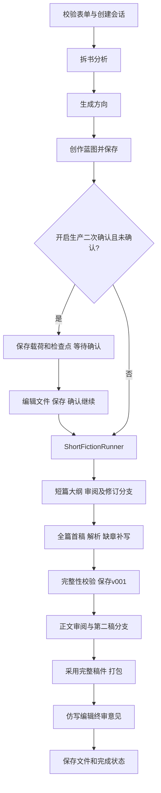

# 06 生产链路、提示词和结果规则

## P01 证据边界

本轮IDA独立导出：短篇主生产`0x180165140`共6320行、最终完整性校验`0x180157690`共634行、仿写蓝图暂停`0x1800d76c0`共1004行，见`source/ida/export-manifest.json`。函数名绑定使用既有`docs/verification/novel-full-draft-20261120/selected-function-bindings.json`及原常量池；IDA文件保留原生地址名，不伪造Python源码。IDA成功不意味着47个API内部全已反编译。

既有带常量注释Ghidra证据仍单独标来源。它帮助解释IDA导出，不更名成IDA证据。下面有“待补”的内容不能列为已证实完整链路。

## P02 仿写短篇：外层准备 → 内层生产 → 外层终审

图表示已恢复路径的结构，不表示每个框一定只调用一次模型，也不表示每种原创/番外都走同一路径。

| 编号/阶段 | 输入 | 输出及保存 | 边界 | 失败/取消 | 证据 |
|---|---|---|---|---|---|
| P03 拆书 | 参考文本、偏好/文风/补充信息 | 拆书材料，供方向和蓝图使用 | 参考分片及重用缓存需按原入口实现，不能把长篇分片直接套短篇 | 失败不把后续阶段点亮；重试不得伪称已生成 | `docs/verification/novel-rea-workflow-20261120/imitation-short-produce.pseudocode.annotated.c:1`及同目录argument-bindings |
| P04 方向 | 拆书结果、用户选定方向 | 方向文件、选定方向 | 未选方向的默认取值需核对实际分支；前端说明不单独证明执行 | 缺有效方向不能凭空继续 | 同上；`NovelImportPage.readable.js:630–635` |
| P05 创作蓝图 | 原文拆解、方向、目标字数/章数、附加要求 | 蓝图文件及后续载荷 | 蓝图是专用前置材料，不等于通用短篇大纲 | 必要材料缺失应停止；不能用空蓝图继续 | `imitation-short-produce.pseudocode.annotated.c:918–950`及原生runner常量 |
| P06 蓝图暂停 | review_config.require_secondary_confirm、检查点确认记录 | 保存运行载荷、awaitingConfirmation=true、checkpoint=blueprint | 未启用或已确认则直接继续；暂停在进入内层runner之前 | 原件文件保存失败行为继续查调用方；确认不是新建第二个作品 | `source/ida/0x1800d76c0.c:1`；`docs/verification/novel-rea-followup-20261120/pause.pseudocode.annotated.c:58–178,332–547` |
| P07 大纲与审阅 | 创作方向、蓝图/参考材料 | 大纲、审阅、可能的修订 | `_run_outline_stages`内部不同分支待继续补函数体，不能凭阶段名称拼成固定三次请求 | 返回空/取消时不能继续正文；原版每个异常文案待补 | `short_fiction_runner`常量#99；主函数`source/ida/0x180165140.c:1`及已存Ghidra完整体 |
| P08 全篇首稿 | 总章数、每章字数、方向、大纲、writer系统提示 | raw原始输出、解析章节、v001 | 使用全篇标记区块；不是每章单独调用通用writer | 空章进入缺章补写；原文需保留用于追查 | `docs/verification/novel-full-draft-20261120/0x1801d6160.fallback.annotated.c:39–287`；主函数 |
| P09 缺章补写 | missing章节号、已生成稿件、方向与大纲 | 补写raw并重新解析 | missing按content.strip为空，非“字数不够”；预算按缺章数量，不按总章数 | 补写次数与退出分支逐段核验；不得无限补试 | `source/ida/0x180157690.c:1`；`docs/verification/novel-full-draft-20261120/FINDINGS.md`的缺章/补写预算章节 |
| P10 首稿最终校验 | 解析章节、expected_chapters | 完整稿件或校验异常 | 检查章数完全一致、没有空章；未见这个helper用45%篇幅阈值替代完整性 | 章数不符/空章明确报错，不生成假final | `source/ida/0x180157690.c:1`；既有同地址annotated.c |
| P11 正文审阅 | 完整正文、方向、大纲、审稿system | 审阅意见 | 正文审阅请求温度0.3、max_tokens8192；不能直接套Agent全局温度 | 请求失败和正文不合格是不同情况 | `docs/verification/novel-short-recovery-20261120/0x180165140.full.assembly.txt:2673`；full-draft的draft-review模板 |
| P12 第二稿 | 原system/user、assistant首稿、revision followup | v002或保留v001并警告 | 原版修订保留会话上下文；第二稿必须再解析和校验，不能覆盖完整首稿为空 | 原版宽泛Exception可回退v001；不能据此将CM取消/未知付费结果/保存失败吞掉 | `docs/verification/novel-full-draft-20261120/FINDINGS.md`“无效第二稿”；主函数与完整Listing |
| P13 打包 | 当前采用的完整稿件、方向、大纲/标题 | final、推荐/包装结果 | 温度0.45、max_tokens4096；final采用v001或v002实际成功稿件 | 打包失败不等于全文丢失；已存正文可恢复，具体原版恢复入口待补 | `docs/verification/novel-short-recovery-20261120/0x180165140.full.assembly.txt:4378`；package模板 |
| P14 编辑终审 | 仿写材料、生成正文 | reviews/editorial.md意见单 | 报告生成和评级通过不是同一个结果；可见原版成功支路保存意见后completed，未见按评级阻止完成 | 原版异常出口继续核验；不能将需修改自动视为无正文 | `docs/verification/novel-rea-followup-20261120/editorial.pseudocode.annotated.c:47–278`及外层produce成功支路 |
| P15 收尾 | 当前完整稿件、包装、可选warning | completed、revision_warning、文件 | completed不代表评级必为可过审；不凭单个100进度事件判成功 | 保存失败不能显示已完成；取消不能打完成标签 | 主函数；`docs/verification/novel-short-recovery-20261120/0x180165140.full.assembly.txt:5284–5438` |

## P16 提示词不能只贴一段文本

每个请求必须登记：系统提示来源、user模板来源、动态字段、历史消息、模型路由、温度/token、解析器、保存位置。缺一项不能标为完整接入。

| 节点 | system / user来源 | 动态及消费规则 | 证据 |
|---|---|---|---|
| 全篇短篇writer | short_fiction_prompts常量136；writer user builder | 自定义short_fiction写作要求追加到system；仿写addendum是另一来源；按章节标记解析，不按JSON硬读 | `docs/verification/novel-full-draft-20261120/writer-system.txt`、`writer-user-template.txt`、`0x180161530.fallback.annotated.c:47–200` |
| 全篇工艺要求 | 常量138 | 嵌在user中；writer及continuation复用，不能遗漏 | 同目录`writer-craft.txt` |
| 缺章补写 | continuation builder | 仍写总章数说明，但max_tokens以missing数估算 | 同目录`continuation-user-template.txt`及FINDINGS |
| 正文审阅 | 常量144 + review user builder | 消费采用稿件，不是原参考文本 | 同目录`draft-review-system.txt`、`draft-review-user-template.txt` |
| 第二稿修订 | revision followup builder | 四消息结构system→user→assistant首稿→user跟进，不能丢assistant上下文 | `docs/verification/novel-short-recovery-20261120/0x1801d8140.fallback.annotated.c:1`及`backend/internal/novelcreation/short_writer_conversation.go`供CM对照 |
| 包装 | 常量150 + package builder | 部分字段strip顺序有区别；解析输出和文件保存同时对应 | full-draft目录`package-system.txt`、`package-user-template.txt` |
| 长篇正文 | build_writer_system_prompt及25个builder | 语言/题材/人称/宪法/核心规则/文风/写前检查/输出格式分支；不能合并成“你是作家” | `docs/reverse-engineering/luoshui-novel-native-20261119/native/0x1801dfdd0.annotated.c:208,464,530,589` |
| 长篇审稿/修订/结算 | auditor/reviser/settler各模块 | 37维+自定义；局部PATCHES与整章REVISED_CONTENT分流；状态增量按原字段 | 原生目录SPEC/ROUTING-SPEC/PATCH-SPEC/STATE-SPEC；这些为历史分析，CM当前落实另核验 |

05中318条记录是按规则选出的提示词字面量和builder候选，不是318个“已接入提示词”。动态拼接的最终请求仍需逐调用方追踪。模型只允许映射为CM自己已配置的模型，凭据不进入文档。

## P17 全篇输出解析

- 标记行匹配`^\s*===\s*TAG\s*===\s*$`，忽略大小写、多行；正文块取最后一个非空，标题/hook取第一个块。重复TITLE的正文兜底取第二个匹配，不是随便取最后一段。
- 标题先去Markdown井号、取首条非空，再处理书名号；章标题规范化与渲染规则单列，不能提前改变顺序。
- raw原样保存；各章content单独清理；不把写前检查和结算混进叙事正文。
- Markdown无显式章节号的宽松兜底存在不同n误取首章的原版缺陷。CM若修正，登记“有意修正原缺陷”，不能宣称原版无问题或逐字等价。
- 字数helper实际是去空白后长度，不是只数汉字；预算`max(12288, ceil(chapter_count * chars_per_chapter * 2.2)+4096)`。

完整精确规则及原生地址/Listing行号：`docs/verification/novel-full-draft-20261120/FINDINGS.md:7–88`。本轮IDA独立验证文件已归档，但未把所有解析helper重新导出为IDA。

## P18 长篇审稿与跨章状态

已有原件函数证据说明存在：审稿→可选本地检查合并→修订分流→择优或回退→状态结算。原文正文、审核问题、PATCHES、UPDATED_STATE、伏笔增量是不同对象。旧报告中的差距可能已被后续修复，不能当当前差距直接复制。

仍须补全：每种创作模式的完整callgraph；StateValidator实际输入/失败修正；角色关系/事实有效期/伏笔生命周期全部分支；每个动态builder的实际消费；所有取消和文件写失败分支。来源与现有覆盖分别见原生目录`native-index.json`和`STATE-SPEC.md`。

## P19 取消与恢复：必须分三层

1. 表单取消：不提交请求，不创建新作品；草稿是否保留按各组件实现分别测试。
2. 已提交任务取消：使用取消操作，停止后续调用；不是只关弹窗。原版取消对象传播到每个pipeline的完整路径尚未全部恢复。
3. 网络结果未知：不得当作明确失败自动重试；CM的防重复收费保护是额外实现约束，不能伪称原版相同。已确认provider拒绝和未知结果必须区别。

原生桥接存在`novels_cancel_operation`常量；仅凭该名称不能标所有取消链路通过。当前原版前端在发送返回cancelled时抑制普通失败提示，见`NovelStudioPage.readable.js:488–491`。

## P20 当前CM对照，只记录本次读到的事实

| 项目 | 当前CM源码事实 | 状态 |
|---|---|---|
| 短篇全篇稿件与版本 | `backend/internal/novelcreation/short_full_pipeline.go:14–65`有v001/v002、补写/警告/当前采用稿件和final刷新 | 有实现；不能据此证明所有分支等价 |
| 原生意见单与评级 | `short_imitation_pipeline.go:314–365`仍校验报告结构；仅旧版本<2遇非通过评级返回失败 | 新旧任务分开，不再把旧报告的“所有版本都阻止完成”当当前事实 |
| 后台预设词 | `backend/internal/prompt/novelcreation/admin_presets.go:19–65`注册全篇首稿、补写、审稿、修订、包装、区块等模板 | 有登记；需继续核对每个调用读取和最终请求 |
| 通用大纲与专用蓝图 | `short_full_pipeline.go:65–78`将仿写蓝图与通用大纲拼接；原版内层outline阶段也存在 | 是否内容/顺序等价未确认，不能因两种名称存在便断言是多余调用 |
| 真实成品验收 | `docs/verification/2026-11-20-novel-live-chain-test.md:1–25`记录当时两次首步失败、0章，通道503 | 历史实跑未通过；本轮无新收费请求，不冒称现时已生成成功 |

本节不是完整CM差异审计；未读取的页面和后端分支统一待核验。
