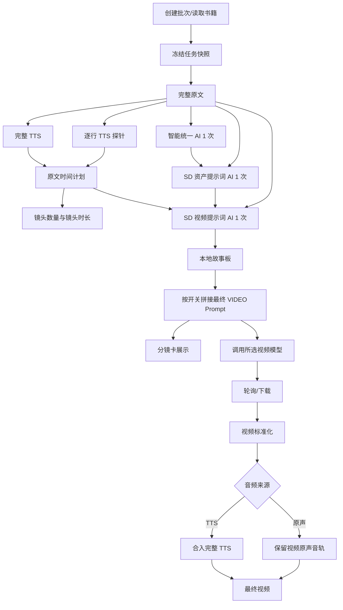

# 批量工厂完整链路思维导图

> 版本：2026-10-14  
> 目的：说明批量工厂从原文、配音、资产、分镜到最终视频的完整关系。  
> 核心原则：AI 负责生成内容，系统负责事实、时间、开关、校验和最终拼接。

## 一、总链路



## 二、批次和按钮

### 1. 批量工厂首页

| 按钮 | 作用 | 是否调用 AI |
|---|---|---:|
| 新建批量 | 新建批次、添加书籍、选择范围、选择截取、设置立即或定时执行 | 否 |
| 刷新 | 重新读取当前批次列表和状态；按钮显示旋转状态 | 否 |
| 批量操作 | 对勾选书籍执行、暂停、取消或重试 | 按实际动作 |
| 上传网络 | 执行最终视频上传 | 否，调用上传接口 |
| 小说列表 | 查看当前批次书籍 | 否 |
| 统一配置 | 打开当前批次的公共配置 | 否 |
| 刷新智能统一 | 重新获取当前书的统一风格分析 | 是，1 次 |
| 自动生产 | 打开内容范围、内容截取、并发、立即执行、定时任务配置 | 否 |
| 任务/日志 | 查看执行状态、失败原因、AI/TTS/视频记录 | 否 |

### 2. 单本书操作

| 区域/按钮 | 作用 |
|---|---|
| 查看原文 | 查看本书原文，不改原文 |
| 编辑正文 | 修改原文；修改后会使时间计划和下游结果失效 |
| 下载 TXT | 下载原文 |
| 删除本书 | 从当前批次移除本书 |
| 引擎配置 | 选择视频模型、视频提示词预设、画幅、分辨率、分镜时长、音频来源 |
| 资产设置 | 选择 SD/H3 资产提示词预设并管理人物、场景、道具 |
| 约束设置 | 控制最终分镜卡显示哪些附加内容 |
| 配音与时长 | 生成完整配音、逐行测量、建立原文时间计划 |
| 分镜提示词 | 获取、查看、重新生成最终视频提示词 |
| 图片与视频 | 提取资产、生成图片、生成视频、刷新、重试 |

## 三、文本 AI 调用

### 1. 智能统一：1 次

输入：完整原文、人工风格建议、成片形式。  
输出：

- 内容类型
- 故事时代和世界观
- 核心关系和冲突
- 情绪基调
- 全片统一视觉风格
- SD 专用统一风格文本

它只描述全片风格，不描述具体人物、具体场景、动作或单镜头机位。

### 2. SD 资产提示词：1 次

以下阶段合并为一次 AI 调用：

```text
正式人物名单
+ 人物事实
+ 人物外形
+ 人物关系
= SD 资产提示词
```

输出：

- 统一人物
- 人物身份、性别和年龄阶段
- 人物外形、服装、发型、配饰
- 人物关系和别名绑定
- 场景资产
- 道具资产
- 资产之间的稳定关联

资产提示词是后续分镜和视频生成的稳定锚点。不能在每个镜头中重新随意生成一套人物。

### 3. SD 视频提示词：1 次

以下阶段合并为一次 AI 调用：

```text
故事剧本
+ 导演分镜计划
= SD 视频提示词
```

输入包括：

- 冻结原文
- 原文时间计划
- SD 资产提示词
- 智能统一结果
- 当前选择的视频提示词预设
- 人工导演要求

输出包括：

- 场景
- 场景环境
- 对应原文行
- 镜头内容
- 景别
- 机位
- 构图
- 运镜
- 光线
- 可视重点
- 镜头结束状态

AI 不能修改系统已经锁定的原文行数、镜头数量、镜头顺序、原文覆盖范围和镜头时长。

## 四、配音与时长

配音与时长是基础流程，不由“音频来源”开关决定。

### 1. 永远执行

```text
完整原文
├── 完整 TTS 1 次
└── 每行 TTS 探针 1 次
        ↓
    测量每行实际时长
        ↓
    建立原文时间计划
```

即使最后选择“原声”，也要完成这一步，因为分镜和生产时间轴需要时长依据。

### 2. 分镜时长

“分镜时长”是视频请求能力和分段策略，不是 AI 自由决定的时长。

系统同时保存：

- `real_duration_seconds`：真实剧情时长
- `api_duration_seconds`：视频模型实际请求档位

例如真实剧情为 6.230 秒、模型只支持 10 秒：

```text
真实时长 = 6.230 秒
请求时长 = 10 秒
多出的 3.770 秒 = 最后一镜稳定保持
```

不能把多余时长均摊到所有镜头，也不能推进下一行剧情。

### 3. 镜头数量

原文有 5 行，不代表一定只有 5 个镜头：

```text
5 行原文
→ 5 个时间单元
→ 按标点和时长拆分
→ 每行产生 1 个或多个镜头
```

镜头数量和时长由系统时间计划锁定。

## 五、约束设置

约束设置只控制最终分镜卡展示和最终 Prompt 的拼接，不影响前面的生产流程。

| 开关 | 开启时展示/拼入 | 关闭时 |
|---|---|---|
| 基础设定 | 统一人物 | 不展示统一人物 |
| 智能统一 | 统一风格 | 不展示统一风格 |
| 画质约束 | 最终导出画质约束 | 不展示该段 |
| 画面限制 | 画面限制内容 | 不展示该段 |
| 负面提示词 | 最终导出负面提示词 | 不展示该段 |

关闭约束时：

- 不删除已经生成的数据
- 不重新调用 AI
- 不重新生成资产
- 不重新生成故事剧本
- 不重新生成导演分镜
- 不改变原文时间计划
- 不改变视频模型配置

重新打开后，系统直接恢复显示。

## 六、最终 VIDEO Prompt

本地故事板生成后，系统根据选择状态拼出最终 VIDEO Prompt：

```text
统一风格                         ← 智能统一开启时显示
统一人物                         ← 基础设定开启时显示
段内执行约束

场景 1
对应原文第 1 行
场景环境
镜头 1
镜头 2

场景 2
对应原文第 2 行
场景环境
镜头 1

……

最终导出画质约束                 ← 画质约束开启时显示
最终导出负面提示词               ← 负面提示词开启时显示
```

分镜卡展示的是这个最终组合结果，不展示中间 JSON、导演结构或未拼接的内部数据。

## 七、SD/H3 预设关系

视频模型和提示词预设是两个概念：

```text
选择 SD 视频提示词
→ 使用 SD 的视频提示词规则

选择 H3 视频提示词
→ 使用 H3 的视频提示词规则
```

资产提示词同理：

```text
选择 SD 资产提示词
→ 使用 SD 资产规则

选择 H3 资产提示词
→ 使用 H3 资产规则
```

选择的视频模型只是实际执行最终 Prompt 的引擎；真正决定 Prompt 结构的是所选提示词预设。

## 八、最终视频闭环

```text
最终 VIDEO Prompt
    ↓
按模型能力分段
    ↓
提交所选视频模型
    ↓
轮询生成状态
    ↓
下载原始视频
    ↓
读取真实视频时长、尺寸和帧率
    ↓
标准化每个视频片段
    ↓
按时间轴顺序拼接
    ↓
音频来源 = TTS？
    ├── 是：合入完整 TTS
    └── 否：保留视频模型原声
    ↓
最终视频
```

## 九、按钮是否重新生成的判断

| 操作 | 是否重新调用 AI | 是否重新计算时间计划 |
|---|---:|---:|
| 打开/关闭基础设定 | 否 | 否 |
| 打开/关闭智能统一显示 | 否 | 否 |
| 打开/关闭画质约束 | 否 | 否 |
| 打开/关闭画面限制 | 否 | 否 |
| 打开/关闭负面提示词 | 否 | 否 |
| 刷新智能统一 | 是，1 次 | 否 |
| 生成 SD 资产提示词 | 是，1 次 | 否 |
| 重新生成 SD 视频提示词 | 是，1 次 | 否 |
| 修改原文 | 需要下游重跑 | 是 |
| 修改配音、语速或音色 | TTS 重跑 | 是 |
| 修改分镜时长 | 否或按实现重编译 | 是 |
| 修改视频模型 | 否 | 否，只重做视频准备和生成 |
| 修改画幅/分辨率 | 否 | 否，只重做视频准备和生成 |
| 修改音频来源 | 否 | 否，只改变最终合成音轨 |

## 十、失败闸门

在以下检查没有通过前，不允许提交视频：

```text
原文行数正确
AND 原文内容未被改写
AND 时间计划守恒
AND 镜头覆盖范围正确
AND 镜头顺序正确
AND 镜头时长守恒
AND 资产提示词结构有效
AND 视频提示词结构有效
AND 视频模型和分辨率有效
```

失败时应显示具体阶段和原因，例如：

- 资产提示词生成失败
- 视频提示词解析失败
- 镜头数量不一致
- 时间轴不守恒
- 视频模型未配置
- 视频任务提交失败
- 视频下载失败
- 视频时长不足

## 十一、最简记忆版

```text
原文 = 剧情事实
TTS = 时间依据
智能统一 = 统一风格
资产提示词 = 统一人物、场景、道具
视频提示词 = 故事剧本和导演镜头
约束开关 = 分镜卡显示开关
分镜卡 = 系统拼好的最终 VIDEO Prompt
音频来源 = 最后使用 TTS 还是原声
视频模型 = 执行最终 Prompt 的引擎
```
