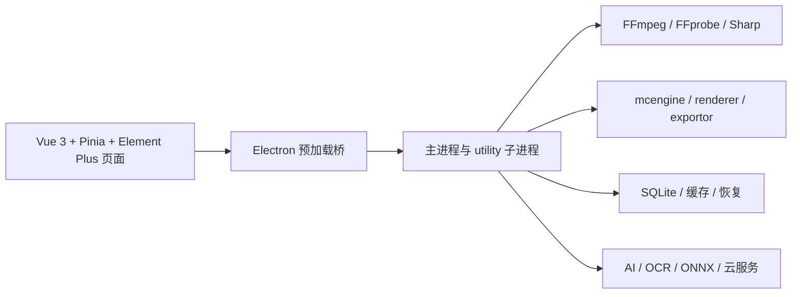

# Magic Cut 1:1 功能与重写完整度报告

> 报告日期：2026-11-20
>
> 报告类型：普通 Electron/JavaScript 逆向与重写核对（`flavor = null`）
>
> 目标版本：`1.5.3-rc.52.23`
>
> 长期台账：[parity/feature-ledger.md](parity/feature-ledger.md)

## 1. 执行摘要

原版 Magic Cut 是一套 Electron 桌面视频生产工作台，不是单独一个剪辑页面。静态源码能确认它包含首页/工程、时间线剪辑、高光与钩子、批量短剧、选剧、仿剪、数字人、达人二创、脚本成片、漫剧转译、AI 前贴、任务中心、数据看板等至少 22 个路由级入口，并依赖 FFmpeg、FFprobe、SQLite、原生 `mcengine`、OCR/ONNX 和多个独立任务进程。

当前 React + Antd + Go 重写已经建立 4040 独立入口，完成账号接入、工程创建、基础素材导入与探测、基础时间线命令、版本化自动保存和通用任务中心。它还没有真实播放器、导出 worker、可播放文件落盘，也没有原版的大部分业务工作流。因此当前结论是“核心底座开发中”，不能称为 1:1 完成。

功能台账共登记 46 项：8 项已完成、15 项部分完成、23 项未开始。最优先缺口是“新建工程 → 导入素材 → 编辑 → 真实导出 → 文件落盘 → 失败重试”的完整闭环。

## 2. 范围和边界

### 2.1 本次读取范围

- 原版载荷：`F:\软件\magic-cut\resources\app.asar`
- 反编译目录：`F:\软件\magic-cut-reverse\decompiled`
- 原逆向文档：`F:\软件\magic-cut-reverse\docs`
- 当前重写：`F:\脚本测试\一战晟铭-v88\magic-cut-workbench`

### 2.2 本次没有做的事

- 没有运行原版程序，没有登录原版账号。
- 没有调用付费 AI、云存储或线上服务。
- 没有把发布包冒充为原始 Vue/TypeScript 工程。
- 没有复制未知的服务端提示词、密钥、品牌资产或内部地址。

## 3. 原版架构和功能面

原版发布包中的主要路由和业务如下：

| 业务面 | 路由或源码块 | 主要能力 |
|---|---|---|
| 首页和工程 | `/`、`/dashboard`、`Home-B-_BdFFe.js` | 概览、近期工程、新建和多种成片入口 |
| 主剪辑器 | `/cut/:id`、`index-DYyX8dFj.js` | 素材、预览、多轨时间线、属性和导出 |
| 模板/漫剧/顺剪 | `/custom/:id`、`/comic/:id`、`/medit/:id` | 模板创作、漫剧、原片顺剪和批量素材 |
| 高光 | `/highlight/:id`、`/highlight-short-cut/:id` | 高光点、钩子、旁白、翻译、打码和快速成片 |
| 短剧 | `/drama-project/:id`、`/ai-drama-film/:id`、`/batch-drama/:id` | 短剧工程、AI 成片、批量短剧/漫剧 |
| 选剧与仿剪 | `/drama-picker`、`/clone-cut/:id` | 趋势筛选、批量搜索、片头片尾和节奏分析 |
| AI 生成 | `/hot-replication`、`/digital-replace/:id`、`/ai-pre-roll/:id?` | 图生视频、数字人、AI 前贴和配音 |
| 二创和脚本 | `/influencer-recreation/:id?`、`/script-batch-compose/:id?` | 高光混剪、分镜匹配、配音和批量成片 |
| 转译和抓取 | `/comic-trans/:id?`、`/launch-grab/:id`、`/volc/:id` | 多语言字幕、压制、分步抓取和创作流程 |
| 运维 | `/task-center`、`/effect-dashboard`、`/tool-permission` | 任务、成本产量看板和权限 |

预加载桥还证明原版具有文件选择、媒体探测、切片、拼接、抽帧、音频处理、导出、下载、TOS、持久化、心跳、崩溃恢复和更新能力。静态存在只能证明“发布包提供了这项能力”，不能证明每个账号和页面都能实际调用。

## 4. 当前重写已经做到什么

| 层 | 已实现 | 证据位置 |
|---|---|---|
| 入口 | 一战晟铭下拉入口、4040 独立运行 | `frontend/src/shared/layouts/WorkModeMenu.jsx`、`magic-cut-workbench/scripts/start-dev.ps1` |
| 账号 | 复用一战晟铭会话，4040 直接登录兜底 | `api/internal/authbridge/`、`前台/src/features/account-login/` |
| 工程 | 新建、保存、列表和所属用户隔离 | `api/internal/project/`、`前台/src/features/project-create/` |
| 素材 | 上传视频/音频/图片、FFprobe 探测、列表和插入 | `api/internal/material/`、`前台/src/features/materials/` |
| 编辑 | 五区布局、视频/音频轨、插入、分割、复制、删除、撤销/重做 | `前台/src/features/editor/`、`前台/src/features/timeline/` |
| 保存 | 修订号、自动保存和冲突暂停 | `api/internal/timeline/`、`Timeline.jsx` |
| 任务 | 持久列表、取消、重试和重启恢复入队底层 | `api/internal/task/`、`前台/src/features/task-center/` |
| 提示词 | 客户端可见原文与自有等价提示词统一放后端 | `api/internal/prompt/catalog.go`、`docs/prompt-inventory.json` |
| 交付 | Vite 资源由 Go `embed` 提供，4040 单服务运行 | `api/web/web.go`、`api/web/dist/` |

## 5. 为什么现在还不是 1:1

### 5.1 核心闭环还缺最后也是最关键的一段

当前“导出”按钮没有连接导出参数、渲染计划或 worker。播放器也没有加载真实素材。任务中心虽然真实持久化，但还没有真实导出任务给它执行。因此接口、页面和测试通过不能替代“输出文件真实落盘并可播放”。

### 5.2 大部分业务工作流尚未实现

高光、短剧、批量短剧、选剧、仿剪、数字人、达人二创、脚本成片、漫剧转译、AI 前贴和效果看板都只有原版源码证据，当前重写没有完整页面和后台执行链。

### 5.3 静态源码有明确上限

以下三项必须以后用隔离环境补证：

1. 原版每个路由在空、加载、成功、失败、无权限、额度不足和断网时的准确像素与弹窗。
2. 原版线上接口的完整参数、权限、额度和错误语义。
3. `mcengine`、`mce_renderer`、OCR/ONNX 的精确输入输出与性能边界。

## 6. 提示词核对

反编译源码中能直接证明的客户端约束已经登记到后端，例如：

- `不生成字幕；画面无水印、台标和乱码。`
- 独立旁白与画面声音的混合边界。
- “独立解说旁白”和“只生成人物对白”两种语音策略。

这些内容来自 `assets/index-lgtcjTmg.js`，登记在 `docs/prompt-inventory.json`，运行时只允许由 `api/internal/prompt` 返回。爆款复刻和脚本分镜匹配的服务端原提示词不在发布包里，当前使用的是明确标记为 `derived-equivalent` 的自有等价版本，不能写成“恢复了原版提示词”。

## 7. Evidence → Finding → Path

### 7.1 Evidence

#### E-001

- title: 原版载荷身份与完整性
- observed_at: 2026-11-20
- source_type: file
- source_ref: `F:\软件\magic-cut\resources\app.asar`
- content_hash: `2FD5AA2AA61A964B4AD2579160771CD4778BDCB98F64A5A0588183349B49B7E1`
- artifact_path: `F:\软件\magic-cut-reverse\decompiled`
- repro_command: `Get-FileHash -Algorithm SHA256 -LiteralPath 'F:\软件\magic-cut\resources\app.asar'`
- raw_excerpt: ASAR 共 4,229 个条目、3,561 个文件；完整解包 861,778,194 字节。
- linked_workitem: `MC-001` 至 `MC-046`
- supersedes: none

#### E-002

- title: 页面和工作流路由
- observed_at: 2026-11-20
- source_type: file
- source_ref: `F:\软件\magic-cut-reverse\decompiled\assets\main-xfhf5XFh.js` 及命名页面块
- content_hash: 见 E-001 的载荷哈希
- artifact_path: `F:\软件\magic-cut-reverse\decompiled\assets`
- repro_command: `rg -n "highlight|batch-drama|drama-picker|clone-cut|hot-replication|digital-replace|influencer-recreation|script-batch-compose|comic-trans|ai-pre-roll|task-center" 'F:\软件\magic-cut-reverse\decompiled\assets'`
- raw_excerpt: 静态路由和页面块覆盖主剪辑器以及多个独立生产工作流。
- linked_workitem: `MC-003`、`MC-010`、`MC-025` 至 `MC-040`
- supersedes: none

#### E-003

- title: 本地媒体、导出和恢复能力
- observed_at: 2026-11-20
- source_type: file
- source_ref: `F:\软件\magic-cut-reverse\decompiled\context\main.context.v2.js`
- content_hash: 见 E-001 的载荷哈希
- artifact_path: `F:\软件\magic-cut-reverse\decompiled\context\main.context.v2.js`
- repro_command: `rg -n "ffmpeg|ffprobe|export|smart-clip|watchdog|tos|download|subtitle" 'F:\软件\magic-cut-reverse\decompiled\context\main.context.v2.js'`
- raw_excerpt: 页面通过预加载桥调用媒体处理、导出、存储、下载和稳定性能力。
- linked_workitem: `MC-007` 至 `MC-009`、`MC-020` 至 `MC-024`、`MC-045`、`MC-046`
- supersedes: none

#### E-004

- title: 客户端可见提示词与声音策略
- observed_at: 2026-11-20
- source_type: file
- source_ref: `F:\软件\magic-cut-reverse\decompiled\assets\index-lgtcjTmg.js`
- content_hash: 见 E-001 的载荷哈希
- artifact_path: `magic-cut-workbench/docs/prompt-inventory.json`
- repro_command: `node magic-cut-workbench/tools/extract-prompt-candidates.mjs`
- raw_excerpt: 两条客户端约束和两条语音策略已有精确来源；两个服务端行为只允许写自有等价版本。
- linked_workitem: `MC-032`、`MC-035`、`MC-038`、`MC-041`
- supersedes: none

#### E-005

- title: 当前重写的真实接口和页面
- observed_at: 2026-11-20
- source_type: file
- source_ref: `magic-cut-workbench/api/internal/httpapi/router.go`、`magic-cut-workbench/前台/src/app/App.jsx`
- content_hash: 由 Git 提交固定
- artifact_path: `magic-cut-workbench`
- repro_command: `rg -n "api/magic-cut|TaskCenter|EditorPage|HomePage" magic-cut-workbench/api magic-cut-workbench/前台/src`
- raw_excerpt: 当前路由只覆盖账号、工程、素材、时间线和任务中心。
- linked_workitem: `MC-001` 至 `MC-025`、`MC-041` 至 `MC-044`
- supersedes: none

#### E-006

- title: 已完成步骤的 Git 记录
- observed_at: 2026-11-20
- source_type: command
- source_ref: Git 历史
- content_hash: n/a
- artifact_path: n/a
- repro_command: `git log --oneline -- magic-cut-workbench`
- raw_excerpt: `b9b1ac6f` 至 `46957c8d` 分别登记底座、账号、存储、提示词、工程、素材、时间线、登录和任务中心。
- linked_workitem: `MC-001` 至 `MC-025`、`MC-041` 至 `MC-044`
- supersedes: none

### 7.2 Findings

#### F-001

- title: 原版是多工作流视频生产平台
- severity: n/a_re
- category: reverse_algo
- status: validated
- evidence_ids: `[E-001, E-002, E-003]`
- location: `app.asar/assets`、`context/main.context.v2.js`
- impact: 重写不能只复制剪辑页，否则会漏掉大部分业务和本地能力。
- confidence: high
- repro_steps: 按 E-002、E-003 命令核对路由和能力名。
- remediation: n/a

#### F-002

- title: 当前重写只完成核心底座的一部分
- severity: n/a_re
- category: other
- status: validated
- evidence_ids: `[E-005, E-006]`
- location: `magic-cut-workbench`
- impact: 现在不能对外声称 1:1，也不能把任务中心当作真实导出。
- confidence: high
- repro_steps: 对比当前 API/页面路由和台账 46 项。
- remediation: 按台账优先完成真实导出闭环。

#### F-003

- title: 服务端原提示词没有被完整恢复
- severity: n/a_re
- category: other
- status: validated
- evidence_ids: `[E-004, E-005]`
- location: `docs/prompt-inventory.json`、`api/internal/prompt/catalog.go`
- impact: 必须区分客户端原文和自有等价提示词，避免错误宣称和前端硬编码。
- confidence: high
- repro_steps: 检查每条提示词的 `classification` 和 `sourceLocation`。
- remediation: 新提示词继续只放后端并登记来源类别。

### 7.3 Path

#### P-001

- title: 核心剪辑闭环
- path_type: callflow
- start: 用户从一战晟铭下拉进入 4040
- goal: 导出文件真实落盘、可播放，并能取消或失败重试
- steps:
  1. 账号会话进入首页 — evidence: E-005 — finding: F-002
  2. 新建工程并保存 MySQL — evidence: E-005, E-006 — finding: F-002
  3. 上传素材并由 FFprobe 探测 — evidence: E-003, E-005 — finding: F-002
  4. 素材进入版本化时间线并自动保存 — evidence: E-005, E-006 — finding: F-002
  5. 根据时间线创建导出计划 — evidence: E-003 — finding: F-001
  6. worker 渲染、写出文件并把进度写入任务中心 — evidence: E-003 — finding: F-001
- residual_risks: 第 5、6 步当前尚未实现；真实播放器和原版渲染差异也未验证。

## 8. 后续开发顺序

1. 先完成真实播放器、导出参数、FFmpeg worker、文件落盘和任务进度，把 P0 闭环跑通。
2. 再补字幕/文字、音频/TTS、贴纸/转场/特效，完善通用编辑底座。
3. 然后按高光 → 批量短剧 → 仿剪 → 脚本成片 → 转译 → 数字人/AI 前贴逐个工作流实现。
4. 每完成一项，同一提交更新 `parity/feature-ledger.md`，记录测试和真实运行结果。
5. 最后再做隔离环境的原版/新版页面、交互、输出和像素 A/B。

## 9. 报告自检

- 报告使用普通逆向模板，没有误套恶意软件或 APT 报告。
- 范围、限制、Evidence、Finding、Path 均已写明。
- 每个“已完成”都有当前代码或验证记录；未实现功能没有写成完成。
- 没有真实密钥、令牌、内部地址或未知服务端提示词。
- 当前状态与长期台账一致：8 项已完成、15 项部分完成、23 项未开始。
